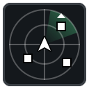

<p align="center">
  
</p>

<h1 align="center">MintyRadar</h1>

<p align="center">
  A client-side Fabric mod for Minecraft 1.21.11 and 26.1 to 26.3 that shows nearby players on a mini radar.
</p>

---

## Features

- **Rotating mini radar, square or round.** Your view direction points up, and players move smoothly on the radar as you turn and walk. Or choose **North Up**: north stays at the top and your arrow turns instead.
- **Terrain map (optional).** A top-down map of the loaded ground under the radar, in vanilla map colours with height shading. **Cave View** maps the floor around your height instead of the surface, and is always on in the Nether.
- **Player heads.** Each player shows as their own skin face, including the hat (outer) layer. You can switch to plain dots instead.
- **Facing lines.** A short line on each player shows which way they're looking.
- **Team colours.** Players are framed and named in their scoreboard team colour.
- **Trails (optional).** Fading dots show where each player has been, up to 2 minutes back.
- **Compass.** N, E, S and W around the edge turn with your view, with north in mint.
- **Distance rings.** Circles at half and full range, labelled with their distance (e.g. 32m and 64m).
- **Height markers.** A **Δ** shows a player is above you, and a **∇** shows they're below you.
- **Players beyond range.** They're pinned to the radar's edge as faded markers, so you still know which way they are.
- **Names on the radar.** Show player names above their heads always, only while you hold sneak, or never.
- **Player alerts.** A message such as "Steve is 40m away", with an optional sound, when a player comes within a distance you choose. A **watch list** can limit alerts to the players you pick.
- **Player list.** Players the radar can see, nearest first, with their head, name, distance and health. Distances turn red as players get close. You can limit how many are shown.
- **Friends.** Add friends by username, then choose whether they show with a mint ★ or are hidden completely. Friends never trigger alerts.
- **Mobs (optional).** Show hostile mobs, or all mobs, as their own heads, taken from the game's models so every mob and variant looks right. Hostile mobs get a red frame and others a gray frame. Mobs only appear on the map, never in the player list.
- **Dropped items (optional)** as small yellow dots.
- **Portals (optional).** Nether portals, end portals and end gateways in loaded chunks show as purple squares.
- **Invisible players (optional).** Off by default. When on, invisible players and mobs show too, marked "(invisible)" in the list.
- **Adjustable text size** for names, the list, the compass and ring labels.
- **Place it anywhere.** Drag the radar to any spot on screen with **Move Radar...** in the settings, or keep it in a corner.
- **Ping in the tab list.** Each player's ping shows in milliseconds (e.g. `42ms`, green to red) instead of signal bars. Your own ping is measured live every second. Other players' pings come from the server, which only updates them every few seconds.
- **Zoom.** Radar range from 16 to 256 blocks, with keys or by holding Left Alt and scrolling.
- **In-game settings screen.** Every setting and keybind can be changed in game. Press `K`, or use Mod Menu's Configure button.
- **Light on performance.** Players and mobs are collected 20 times a second, and each frame only does simple maths. The round background and rings are drawn once into a texture, and the terrain map is built a few rows per tick. Objects are reused rather than recreated, so there's no memory buildup.

Spectators aren't shown, and neither are invisible players and mobs unless you turn that on.

## Requirements

There's a separate jar for each Minecraft version. Every version has the same features.

| Minecraft | Jar | Java |
|---|---|---|
| 26.3 | `MintyRadar-1.3.0+26.3.jar` | 25 |
| 26.2 | `MintyRadar-1.3.0+26.2.jar` | 25 |
| 26.1, 26.1.1, 26.1.2 | `MintyRadar-1.3.0+26.1.jar` | 25 |
| 1.21.11 | `MintyRadar-1.3.0+1.21.11.jar` | 21 |

All versions need [Fabric Loader](https://fabricmc.net/use/installer/) 0.19.5 or newer and [Fabric API](https://modrinth.com/mod/fabric-api) for that Minecraft version. [Mod Menu](https://modrinth.com/mod/modmenu) for that version is optional and adds a Configure button.

MintyRadar is **client-side only**, so servers don't need it installed.

## Installation

1. Install Fabric Loader for your Minecraft version with the [Fabric installer](https://fabricmc.net/use/installer/).
2. Download the MintyRadar jar for your Minecraft version from [Modrinth](https://modrinth.com/mod/mintyradar) or the [Releases](https://github.com/patientJeff/MintyRadar/releases) page, or [build it yourself](#building-from-source).
3. Put it in your `mods` folder along with Fabric API. Mod Menu is optional.
   - On Windows, the `mods` folder is at `%appdata%\.minecraft\mods`.
4. Launch Minecraft with the Fabric profile for your version (e.g. **fabric-loader-26.3**).

## Controls

| Key | Action |
|---|---|
| `R` | Turn the radar on or off |
| `=` | Zoom in (smaller range) |
| `-` | Zoom out (larger range) |
| Hold `Left Alt` + scroll | Zoom in (scroll up) or out (scroll down), without changing hotbar slot |
| `K` | Open the settings screen |
| Hold **Sneak** | Show player names on the radar (with the default setting) |

You can change keybinds under **Options → Controls → Key Binds → MintyRadar**, or in the MintyRadar settings screen.

## Settings

Press `K` in game, or with Mod Menu installed, open **Mods → MintyRadar → ⚙**. Changes apply straight away and are saved to `config/MintyRadar.json`.

| Section | Setting | Default | Description |
|---|---|---|---|
| General | Radar | On | Shows or hides the whole overlay |
| | Map | On | Shows or hides the radar map. When it's off, only the player list shows, at the top of the screen |
| | Range | 64 blocks | Radar radius: 16, 24, 32, 48, 64, 96, 128, 192 or 256 blocks |
| Radar Display | Shape | Square | Square or Round |
| | Rotation | Heading Up | Heading Up (turns with your view) or North Up (north stays at the top, your arrow turns) |
| | Markers | Player Heads | Player Heads or Dots |
| | Head Size | 8px | Size of the heads on the radar (4 to 16px) |
| | Player Names | While Sneaking | When names appear above radar markers: Always, While Sneaking or Never |
| | Height Markers | 3 blocks | How far above or below you a player must be before Δ or ∇ shows |
| | Compass | On | N/E/S/W letters around the edge |
| | Distance Rings | On | Labelled circles at half and full range |
| | Facing Lines | On | A short line on each player showing which way they're looking |
| | Team Colours | On | Frame and name players in their scoreboard team colour |
| | Invisible Players | Off | Also show invisible players and mobs, marked "(invisible)" in the list |
| | Mobs | Off | Off, Hostile Only, or All |
| | Dropped Items | Off | Small yellow dots for items on the ground |
| | Portals | Off | Purple squares on nether portals, end portals and end gateways in loaded chunks (rescanned every 5 seconds) |
| | Trails | Off | Fading dots showing where each player has been |
| | Trail Length | 20 s | How far back trails go (3 to 120 seconds) |
| Terrain | Terrain Map | Off | A top-down map of the loaded ground under the radar |
| | Terrain Opacity | 85% | How strong the terrain map is (10 to 100%) |
| | Cave View | Off | Map the floor around your height instead of the surface. Always on in the Nether |
| Player List | Player List | On | The list of players and distances |
| | List Limit | All | Most players to list (1 to 20, or All). The rest show as "+N more" |
| | Health in List | On | Each player's health (with absorption) after their distance |
| Alerts | Player Alerts | On | Message when a player comes within the alert distance |
| | Alert Distance | 48 blocks | How close a player must come to trigger an alert (8 to 128) |
| | Alert Sound | On | Plays a sound with the alert |
| | Watch List Only | Off | Only alert for players on the watch list |
| | Add to Watch List | | Type a username and click **Add to Watch List** or press Enter. Each name has a **Remove** button |
| Layout | Corner | Top Left | Which screen corner the radar sits in. Choosing a corner undoes a dragged position |
| | Move Radar... / Reset to Corner | | **Move Radar...** opens a screen where you drag the radar anywhere. **Reset to Corner** puts it back |
| | Size | 90px | Width and height of the radar |
| | Margin | 6px | Gap between the radar and the screen edge |
| | Background | 56% | Opacity of the radar background |
| | Text Size | 100% | Size of all radar text (50 to 200%) |
| Tab List | Ping in Tab List | On | Ping in milliseconds instead of signal bars |
| Friends | Friends | Show with Star | Show with Star, or Hide (left off the radar and list) |
| | Add Friend | | Type a username and click **Add Friend** or press Enter. Each friend has a **Remove** button |

Each player alerts once, and again only after they move 8 blocks beyond the alert distance and come back. Players who are already nearby when you join a world don't trigger alerts.

The radar also hides while the HUD is hidden (F1) or the debug screen is open (F3).

## ⚠️ Server rules

Many multiplayer servers don't allow radar or minimap mods that show player positions, and using one may get you banned. **Check a server's rules before using MintyRadar on it.** It's fine in singleplayer and on servers that allow it.

**Invisible Players** and **Portals** go further than a normal radar: they show players you couldn't see and portals hidden underground. Even servers that allow minimaps often count those as cheating, which is why they're off by default.

## Building from source

You need **JDK 25** (for 26.x) and **JDK 21** (for 1.21.11).

```bash
git clone https://github.com/patientJeff/MintyRadar.git
cd MintyRadar
./gradlew buildAndCollect    # Windows: .\gradlew.bat buildAndCollect
```

This builds every version and copies the jars to `build/libs/<mod version>/`. To build one version, run e.g. `./gradlew :1.21.11:build` (its jar is in `versions/1.21.11/build/libs/`).

To try a version in a development copy of the game, which also loads Mod Menu:

```bash
./gradlew :26.3:runClient
```

To run the automated test for a version, which opens a small, silent test client, turns on every radar feature in a test world and takes screenshots into `versions/<version>/build/run/clientGameTest/screenshots`:

```bash
./gradlew :1.21.11:runClientGameTest
```

> `gradle.properties` sets `org.gradle.java.home` and `org.gradle.java.installations.paths` to Windows JDK paths. On another system, change or remove those lines so they point at your own JDK 25 and 21.

### Publishing to Modrinth

`./gradlew publishMods` uploads every version's jar to Modrinth as its own version. Each one gets:

- its Minecraft versions from `mod.mc_releases` in `stonecutter.properties.toml`
- the Fabric loader
- Fabric API as a required dependency and Mod Menu as optional
- this version's section of `CHANGELOG.md` as its changelog

To upload for real:

1. Set `modrinth.id` in `stonecutter.properties.toml` to the project's ID or slug.
2. Put a Modrinth personal access token with the "Create versions" permission in the `MODRINTH_TOKEN` environment variable.

Without both, it's a dry run that uploads nothing.

### How versions are handled

One set of sources builds every version with [Stonecutter](https://stonecutter.kikugie.dev):

- `src/` is written for **26.3**.
- `stonecutter.properties.toml` lists each version's dependencies.
- Renames between versions (like `GuiGraphics` in 1.21.11 becoming `GuiGraphicsExtractor` in 26.1) are listed once in `stonecutter.gradle.kts`.
- The few lines that need different code use `//? if >=26.2 {` comments, mostly in the helpers at the bottom of `RadarClientMod`.

To edit the sources as another version, for example to debug 1.21.11 in the IDE, run `./gradlew "Set active project to 1.21.11"`. Switch back to 26.3 before committing.

### Project layout

| File | Purpose |
|---|---|
| `RadarClientMod` | Entrypoint: loads the config and registers the keybinds, tick handler and HUD element |
| `RadarManager` | Collects and sorts players (and mobs and items) each tick, records trails, scans for portals, then works out where markers go on the radar |
| `RadarHudOverlay` | Draws the radar, terrain, rings, compass, portals, trails, markers, height indicators, names and the player list |
| `RadarTerrain` | Builds the terrain map a few rows per tick into a texture, and cuts it to a circle for the round radar |
| `RadarDecor` | Paints the round background and the rings into textures once, so they cost one draw each per frame |
| `PlayerAlerts` | Shows the alert message and plays the sound when a player comes within range |
| `HudPositionScreen` | The Move Radar screen for dragging the radar anywhere |
| `PingTracker` | Measures your own ping live, the same way F3's network chart does |
| `mixin/PlayerTabOverlayMixin` | Draws ping numbers in the tab list and widens its columns to fit |
| `mixin/ClientPacketListenerMixin` | Times ping replies the moment they arrive |
| `mixin/MouseHandlerMixin` | Scroll zoom: the mouse wheel zooms the radar while the scroll zoom key is held |
| `RadarConfig` | Settings, the friends list and the watch list, saved as JSON |
| `RadarConfigScreen` | The settings screen, built from vanilla menu components |
| `Keybindings` | Keybind registration and handling, including the key that opens the settings screen |
| `ModMenuIntegration` | Adds the settings screen to Mod Menu's Configure button (only used when Mod Menu is installed) |

## Update log

See [CHANGELOG.md](CHANGELOG.md) for what's new in each version.

## License

[MIT](LICENSE) © 2026 patientJeff
